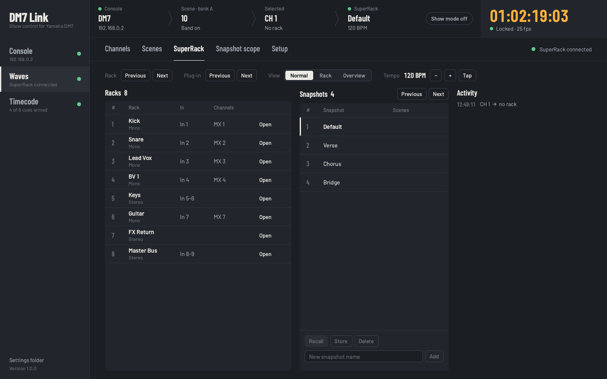

# DM7 Link

Show control for the **Yamaha DM7**, on a Mac or Windows laptop at FOH.

- **Console.** Finds the DM7 on the network, connects, and reconnects by itself.
- **Waves SuperRack.** The desk's SEL opens the rack that channel feeds in SuperRack, read from
  the desk's and SuperRack's own patch, and pressing it again steps to the next plug-in
  (switchable). A scene recall recalls a SuperRack snapshot, and a scene store stores one. The
  desk's tempo sets SuperRack's tempo. SuperRack's racks and snapshots can be controlled from the
  app, and Show mode locks it to show use. SuperRack can be fed by the desk's **PY card** or over
  **Dante**.
- **Timecode.** LTC into any audio interface input. A cue list recalls DM7 scenes or runs macros
  when the timecode plays through each cue. Cues can be grouped in songs, the timeline shows one
  lane per hour, and Live update moves a cue to the incoming timecode.
- **Macros.** Short programs built from blocks (set, change, fade, scene, if, while, for, wait…)
  that act on the desk, started by hand or by a condition, a value change, a timer, a time of
  day, timecode or a scene recall. Every run has fixed limits.
- **Show files.** One `.dm7show` file holds a whole show: features, the Waves tables and
  settings, the cue list, every macro, and the desk it was built on (scene list, channel names,
  every setting). **Work offline** puts that desk in place of the console, so a show can be
  prepared with no console on the table. When the console no longer matches the show (a scene
  renumbered, renamed or deleted, a channel renamed), a window lists every cue, macro and table
  entry affected and offers to follow, keep or remove each.
- **Settings.** Each of Waves, Timecode and Macros can be switched off; a part that is off stops
  and is hidden.



**[User guide](docs/GUIDE.md)**: everything the app does, step by step.

## Run it

```bash
pip install -r requirements.txt
python3 run.py                 # connect to the console last used
python3 run.py 192.168.0.2     # ...or to this one
python3 run.py --offline       # the show file's desk instead of the console
python3 run.py --show Tour.dm7show
```

Python 3.10 or later. DM7 Link lives in a repository beside the DM7 library it is built on
(`../dm7`, `../dm7-gui`, `../rack-bridge`), and finds those folders by itself.

### A single application

```bash
pip install pyinstaller
python3 build.py               # dist/DM7 Link.app on macOS, dist/DM7 Link/DM7 Link.exe on Windows
```

Build on the system you are building for.

## Waves SuperRack

DM7 Link is the console SuperRack's ProLink remote talks to, so no other bridge is needed.

1. **Waves ▸ Setup**: switch the link on, and choose the **Adapter** on the network SuperRack
   is on. The page shows that adapter's address as **Console IP in SuperRack**.
2. In SuperRack: **Setup ▸ Controllers ▸ + ▸ ProLink**. Type that address as **Console IP**,
   choose a **wired** adapter with link as **Port**, then tick **Assign**.
   Wi-Fi does not work as the Port.
   - On a Mac running SuperRack itself, `127.0.0.1` works as well.
   - On Windows, allow DM7 Link through the firewall when asked (TCP 50002).
3. **SuperRack is fed by**:
   - **PY card**: PY *k* is SuperRack input *k*. If the card starts further up, set
     **PY 1 arrives on SuperRack input**.
   - **Dante**: choose the **first desk Dante output** that goes to SuperRack and the SuperRack
     input it arrives on. Up to 128 Dante ports from there are read.

| Tab | |
|---|---|
| Channels | every desk channel patched to the card (insert send or return, or an output patch), and the rack its SEL opens. **Follow SuperRack's patch** fills the table from SuperRack's own input patch. Double-click a row to open its rack. |
| Scenes | scene recall **Off**, **Same number** (scene *n* recalls the *n*-th snapshot) or **From table**. Pick scenes to assign a snapshot to all of them, make new snapshots for them, or exclude them. **Test** recalls the snapshot. |
| SuperRack | racks (double-click a rack to rename it) and snapshots (recall, store, delete, add), rack and plug-in navigation, view, tempo and tap. |
| Setup | the link, the card, what follows the desk, tempo source, Show mode. |

**Show mode**, in the top bar, lets only scene recalls, SEL and tempo reach SuperRack. It stays on
across a restart.

Building racks from the desk's patch (rack setup) and snapshot scope / recall safe are not part of
DM7 Link: SuperRack can only change those by reloading its session.

## Timecode

LTC goes into any input of any audio interface (line level, either polarity). On **Timecode**,
choose the interface and the input, and switch **Timecode in** on. The frame rate is detected
on its own, or can be fixed at 24, 25, 29.97 drop-frame or 30.

- **Add cue** adds a cue at the incoming timecode. Click a cue's time to type one, or use −1/+1
  to nudge it a frame.
- A cue recalls a desk scene, the next scene or the previous scene.
- An **armed** cue fires when the timecode plays through it. A locate past a cue fires nothing.
- **Run** recalls the cue's scene now, for rehearsal.
- **Live update** moves the nearest cue to the incoming timecode.

macOS asks for microphone access the first time an input opens.

## Where things are kept

| | |
|---|---|
| macOS | `~/Library/Application Support/DM7 Link/` |
| Windows | `%APPDATA%\DM7 Link\` |
| Linux | `~/.config/dm7link/` |

`config.json` holds the settings, `racks.json` the channel and scene tables, `cues.json` the cue
list, `macros.json` the macros, `desk.json` and `desk-image.zip` the show's desk, and
`rack-logs/` a daily log of everything sent to SuperRack. **Settings folder**, at the
foot of the window, opens it.

## Development

```bash
python3 check.py                                   # LTC decode, scene cues, show files, window
python3 run.py --demo                              # a recorded console instead of a desk
python3 run.py --demo --ltc-bench 01:00:00:00      # ...and timecode generated in the app
python3 ../rack-bridge/tools/fake_superrack.py     # a stand-in SuperRack that dials in
```

## Licences

Barlow and Barlow Condensed (`dm7link/fonts/`) are by The Barlow Project Authors, under the
SIL Open Font License 1.1 (`dm7link/fonts/OFL.txt`).

DM7 Link is not made by, endorsed by or affiliated with Yamaha or Waves. DM7 is a trademark of
Yamaha Corporation; SuperRack and SoundGrid are trademarks of Waves Audio Ltd.
